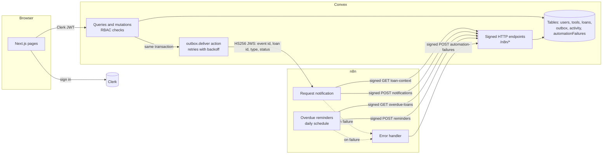
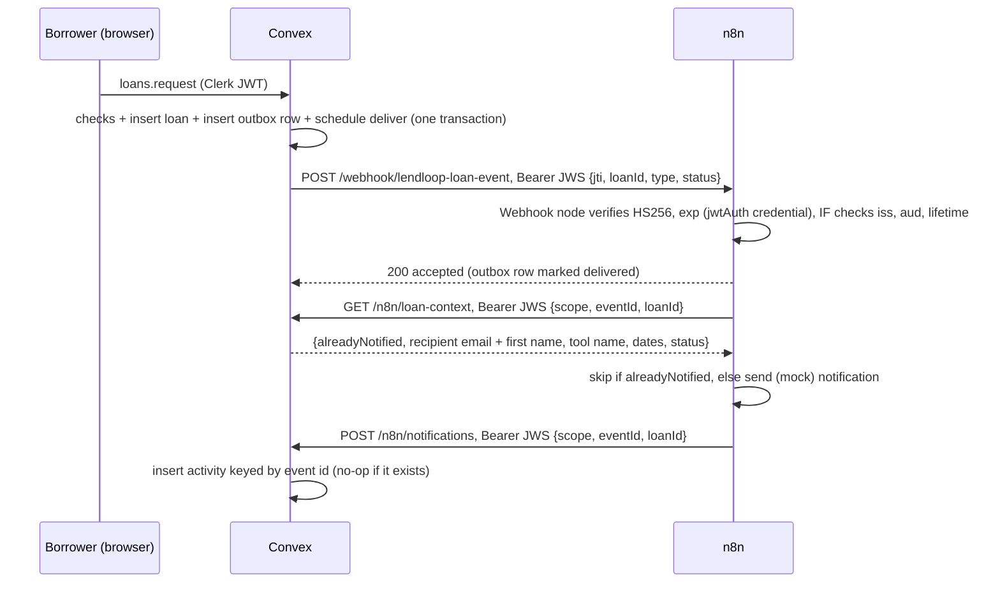

# LendLoop

**Borrow what you need. Lend what you don't.**

LendLoop is a tool-lending board for a neighborhood. Neighbors list tools they can spare, others request
them for a date range, the lender approves or declines, and n8n sends the notifications and the
overdue reminders.

Stack: Next.js 16 (App Router, TypeScript strict, Tailwind 4), Clerk for sign-in, Convex for data and
backend logic, n8n 2.10 for the workflows, Vitest with `convex-test` for tests.

## Contents

- [What it does](#what-it-does)
- [Architecture](#architecture)
- [Local setup](#local-setup)
- [Environment variables](#environment-variables)
- [Tests and checks](#tests-and-checks)
- [Security and data-minimization decisions](#security-and-data-minimization-decisions)
- [Reliability and error handling](#reliability-and-error-handling)
- [Deploying to a single Docker host](#deploying-to-a-single-docker-host)
- [What I'd change for production](#what-id-change-for-production)

## What it does

**Public page** (`/`): the tagline, a "Sign in to lend or borrow" button wired to Clerk, and a
read-only list of the tools available today. The list shows a name and a category and nothing else.

**Signed in:**

- **Browse** (`/tools`): every listed tool with its availability ("Available", "On loan", "Overdue")
  and booked dates, filterable by category. Request a tool for a date range with an optional message.
- **My listings** (`/listings`): add, edit and delete your own tools (name, category, condition,
  short description).
- **My requests** (`/requests`): what you asked to borrow, its status, and cancel while pending.
- **Incoming requests** (`/incoming`): approve or decline requests for your tools, mark loans returned.
- **Admin** (`/admin`, admins only): automation health (undelivered events with a Retry button,
  failed n8n runs), members (mark Trusted Lender, change roles), all loans, all listings with Remove.
- Each loan shows its recent automation activity, for example "Overdue reminder sent to the borrower
  · 2 days ago".

**Rules, enforced in Convex:**

| Rule | Where |
| --- | --- |
| Only signed-in users can do anything except read the public list | `requireUser` in every function |
| Users edit and delete only their own listings | `assertToolOwner` in `tools.update` / `tools.remove` |
| Admins can remove any listing, view all loans, mark a Trusted Lender | `requireAdmin` in `convex/admin.ts`, `isAdmin` in `tools.remove` |
| You cannot request your own tool | `loans.request` |
| Dates must be valid, start today or later, end on or after the start, last at most 30 days | `assertValidLoanRange` |
| A request cannot overlap an approved loan, and an overdue loan blocks the tool until it is returned | `assertNoApprovedOverlap`, checked on request and again on approval |
| Only the lender approves or declines; approving declines the other pending requests for those days | `loans.approve` / `loans.decline` |
| Only the borrower cancels a pending request | `loans.cancel` |
| The lender or an admin marks a loan returned | `loans.markReturned` |
| Roles change only through an existing admin or the CLI; nobody can promote themselves | `admin.setRole`, `users.setRoleFromCli` (internal) |

## Architecture



The request notification, step by step:



### Code map

| Path | What is there |
| --- | --- |
| `convex/schema.ts` | Tables and indexes, with a comment on each table |
| `convex/lib/auth.ts` | `getCurrentUser`, `requireUser`, `requireAdmin`, ownership checks |
| `convex/lib/loans.ts` | Overlap and availability rules, `changeLoanStatus` (status change + outbox event), loan view |
| `convex/lib/outbox.ts` | `enqueueLoanEvent`, the transactional half of the outbox |
| `convex/outbox.ts` | Delivery action, retry and failure handling, stuck-row sweeper |
| `convex/lib/jws.ts` | HS256 sign and verify with Web Crypto |
| `convex/http.ts` | The signed `/n8n/*` routes and the shared verification wrapper |
| `convex/n8n.ts` | Internal functions behind those routes (scoped reads, idempotent writes) |
| `convex/tools.ts`, `loans.ts`, `admin.ts`, `users.ts` | Public Convex functions used by the UI |
| `convex/seed.ts` | `seed:demo` demo data, internal only |
| `convex/*.test.ts` | `convex-test` suites |
| `app/`, `components/`, `lib/` | Next.js pages and UI |
| `n8n/workflows/*.json` | Exported workflows, credentials referenced by name only |
| `n8n/import.sh` | Creates the n8n credentials from env vars, imports and publishes the workflows |
| `docker-compose.yml` | Local n8n |
| `deploy/home-server/` | Compose file and deploy script for one Docker host (self-hosted Convex + app) |
| `scripts/e2e.sh` | Live end-to-end check of the Convex to n8n to Convex loop |

## Local setup

You need Node 20.9 or newer and Docker.

**1. Install**

```bash
npm install
cp .env.example .env.local
```

**2. Clerk.** Create a development application in the Clerk dashboard (or run
`npx clerk@latest init` in a scratch folder to get an unclaimed one without an account), and put its
publishable and secret keys in `.env.local`. Then give Convex a token it accepts, one of:

- Clerk dashboard, **JWT templates**, **New template**, pick the **Convex** preset, keep the name
  `convex`. LendLoop reads `name`, `given_name` and `email` from it.
- or activate the Convex integration in the Clerk dashboard and add `email`, `name` and
  `given_name` claims to the session token.

`ConvexProviderWithClerk` uses the session token when its audience is `convex` and the `convex`
template otherwise.

**3. Secrets and Convex.** Generate the two integration secrets once, into `n8n/.env`, so Convex
and n8n get the same values:

```bash
cp n8n/.env.example n8n/.env
for key in N8N_ENCRYPTION_KEY N8N_WEBHOOK_SECRET N8N_API_SECRET; do
  sed -i "s|^$key=.*|$key=$(openssl rand -hex 32)|" n8n/.env
done
set -a; . n8n/.env; set +a

npx convex dev            # pick a cloud dev deployment or a local one; keep it running in its own terminal
npx convex env set CLERK_JWT_ISSUER_DOMAIN https://<your-app>.clerk.accounts.dev
npx convex env set N8N_WEBHOOK_URL http://localhost:5678/webhook/lendloop-loan-event
npx convex env set N8N_WEBHOOK_SECRET "$N8N_WEBHOOK_SECRET"
npx convex env set N8N_API_SECRET "$N8N_API_SECRET"
npx convex run seed:demo  # optional: three demo neighbors, six tools, one overdue loan
```

Without a Convex account, `CONVEX_AGENT_MODE=anonymous npx convex dev` runs a local backend
(client API on port 3210, HTTP actions on 3211).

**4. n8n.**

```bash
docker compose --env-file n8n/.env up -d   # n8n on http://localhost:5678, create the owner account
set -a; . n8n/.env; set +a
N8N_CONTAINER=lendloop-n8n-1 CONVEX_SITE_URL=http://host.docker.internal:3211 bash n8n/import.sh
```

The container name comes from the folder name; `docker compose ps` shows it if yours differs.

`import.sh` creates two `jwtAuth` credentials ("LendLoop: Convex to n8n" and
"LendLoop: n8n to Convex") from the secrets, imports the three workflows, publishes them and
restarts n8n so the triggers register. On Linux, the Convex local backend listens on 127.0.0.1, which
containers cannot reach through `host.docker.internal`; use a cloud deployment's `.convex.site` URL
as `CONVEX_SITE_URL`, or run Convex on a reachable address.

If you import the JSON through the n8n editor instead, create the two credentials first (type
**JWT Auth**, key type Passphrase, algorithm HS256) and set `convexSiteUrl` in the **Event** and
**Config** nodes.

**5. Run the app.**

```bash
npm run dev                                                     # http://localhost:3000
npx convex run users:setRoleFromCli '{"email":"you@example.com","role":"admin"}'  # after your first sign-in
```

**6. Check the loop.** `bash scripts/e2e.sh` signs in two test identities through the Convex CLI,
lists a tool, requests it, approves it, and waits for n8n to write both notifications back. To test the
reminders, open **LendLoop: overdue reminders** in n8n and click **Execute workflow** (the demo data
has one overdue loan). Running it again the same day sends nothing.

## Environment variables

**Next.js (`.env.local`)**

| Name | Purpose |
| --- | --- |
| `NEXT_PUBLIC_CONVEX_URL` | Convex client URL used by the browser (and by the server unless `CONVEX_INTERNAL_URL` is set) |
| `CONVEX_INTERNAL_URL` | Optional server-only Convex URL, for example `http://convex:3210` inside Docker |
| `NEXT_PUBLIC_CLERK_PUBLISHABLE_KEY` | Clerk publishable key |
| `CLERK_SECRET_KEY` | Clerk secret key, server only |
| `CONVEX_DEPLOYMENT` | Written by `npx convex dev`; tells the CLI which deployment to use |
| `CONVEX_SELF_HOSTED_URL`, `CONVEX_SELF_HOSTED_ADMIN_KEY` | Instead of `CONVEX_DEPLOYMENT` when the backend is self-hosted |

**Convex deployment (`npx convex env set`)**

| Name | Purpose |
| --- | --- |
| `CLERK_JWT_ISSUER_DOMAIN` | Clerk Frontend API URL; Convex accepts tokens from this issuer with audience `convex` |
| `N8N_WEBHOOK_URL` | Production URL of the request-notification webhook |
| `N8N_WEBHOOK_SECRET` | Signs Convex to n8n events. Same value as the "LendLoop: Convex to n8n" credential |
| `N8N_API_SECRET` | Verifies n8n to Convex calls. Same value as the "LendLoop: n8n to Convex" credential |

**n8n**

| Where | Name | Purpose |
| --- | --- | --- |
| `n8n/.env` for `docker-compose.yml` | `N8N_ENCRYPTION_KEY` | Encrypts stored credentials; keep it stable |
| `n8n/.env`, read by `n8n/import.sh` | `N8N_WEBHOOK_SECRET`, `N8N_API_SECRET` | Turned into the two jwtAuth credentials, then the temp file is deleted |
| Shell, read by `n8n/import.sh` | `N8N_CONTAINER`, `CONVEX_SITE_URL`, optional `SSH_HOST`, `RESTART=0` | Target container, Convex HTTP actions URL written into the Config/Event nodes |

**Home server (`deploy/home-server/.env`)**: see `deploy/home-server/.env.example`. It adds
`LAN_IP`, `CONVEX_INSTANCE_SECRET`, `CONVEX_CLOUD_ORIGIN`, `CONVEX_SITE_ORIGIN` and the admin key.

## Tests and checks

```bash
npm run check   # tsc (app and convex), eslint, vitest
npm run build
```

The 60 tests use `convex-test` and `t.withIdentity(...)` instead of real logins:

- `rbac.test.ts`: every role rule, called the way a hostile client would call it.
- `publicList.test.ts`: the public query returns exactly `name` and `category`, hides tools on loan
  or removed, and works signed out; everything else requires sign-in.
- `loans.test.ts`: no self-borrowing, each date rule, overlap rejection on request and on approval,
  overdue loans blocking the tool, auto-decline of clashing requests, one outbox event per change.
- `outbox.test.ts`: the signed payload carries only the allowed claims; retries back off 10, 20, 40,
  80 seconds and then mark the event failed and visible to admins; admin retry; the stuck-row cron;
  a missing webhook URL fails loudly.
- `n8nEndpoints.test.ts`: missing, wrong-secret, tampered, expired, overlong and wrong-scope tokens
  are rejected; loan context is scoped to one event; notification, reminder and failure write-backs
  are idempotent; a second overdue run the same day finds nothing.
- `jws.test.ts`: sign and verify, `alg: none`, tampering, time checks, and interop with
  `jsonwebtoken`, the library n8n's Webhook and JWT nodes use, in both directions.

## Security and data-minimization decisions

**Access control lives in Convex.** The UI hides what you cannot do, and the `(app)` layout sends
signed-out visitors to sign in, but neither is the control. Every public query and mutation starts with
`requireUser` or `requireAdmin` and then checks ownership against the loaded document, so a user who
calls the Convex API directly gets the same answer as the UI. The three exceptions are
`tools.listPublic` (public by design, two fields), `users.store` (creates the caller's own row from
their verified token) and `users.me` (returns the caller's own profile, or null). The role is stored in Convex, defaults to
`user`, and is never read from the Clerk token, so editing Clerk metadata cannot grant admin. The first
admin is created from the CLI with an internal mutation, which the browser cannot call. Admins cannot
change their own role, which avoids locking everyone out.

**The public query returns two fields.** `tools.listPublic` has a `returns` validator of
`{ name, category }[]`. If someone later adds a field to the object, Convex rejects the response
instead of leaking it, and a test checks the exact key set. It has no ids either, so it cannot be used to
probe other functions.

**Other members see a first name.** Signed-in pages show the lender's or borrower's first name and
the Trusted Lender badge. Emails are visible only to admins and are sent to n8n only for the one
message that needs them.

**The webhook carries ids, not data.** The event n8n receives is a signed token with the event id
(`jti`), the loan id, the event type, the status, and `iat`/`exp`. No names, emails or tool details
travel with it, so a leaked webhook log or a misrouted request exposes nothing personal. n8n fetches
what it needs from `/n8n/loan-context`, which is scoped to the one event and loan named in its token
(the event must belong to the loan) and returns the recipient's email and first name, the tool name
and the dates.

**Both directions are signed, with different secrets.** Calls are HS256 JWS tokens in the
`Authorization` header. HS256 is HMAC-SHA256 over the header and claims. I picked the JWS format
over a custom signature header because n8n handles it natively: the Webhook node verifies it with a
**JWT Auth** credential and the JWT node signs it with another, so the secrets live in n8n credentials
and never in workflow JSON, Code nodes or `$env`. Each direction has its own secret and its own
issuer/audience pair, so a token from one side is useless on the other. Convex verifies with Web
Crypto in `convex/lib/jws.ts`: the algorithm is pinned to HS256 (no `alg: none`), the signature is
compared in constant time, issuer and audience must match, `exp` must be in the future, `iat` at most
60 seconds ahead, and the lifetime at most 5 minutes. Each n8n token also names a `scope`, and each
endpoint accepts only its own scope. The request body is never read: the signed claims are the request,
so nothing unsigned can sneak in.

**Replays.** The short lifetime limits the window. Inside it, a replayed read returns data the holder of
the token already had, and a replayed write hits an idempotency key and changes nothing. Convex to n8n
events use the event id as `jti`, and the workflow skips events that already have an activity record.
I did not add a used-`jti` store because every write is already idempotent; it is listed under
production changes.

**Idempotent write-backs.** Notifications are keyed by event id, reminders by `loanId:YYYY-MM-DD`,
failure reports by n8n execution id. Each write-back looks up the key first and returns
`{ created: false }` when it exists, inside one Convex transaction, so retries and concurrent calls
cannot create duplicates.

**Input validation.** Convex argument validators check types and ids on every function. On top of
that, text is trimmed and length-limited, dates must be real calendar days, and claims from n8n go
through the internal functions' validators (a bad claim is a 400, not a crash).

**Secrets.** Real values live in `.env.local` (git-ignored), on the Convex deployment, in n8n
credentials, and in the server's `chmod 600` `.env`. `n8n/import.sh` writes the credentials file
with `umask 077` and deletes every copy when it exits, even on failure. The repo has `.env.example`
files only, and Clerk's keyless `.clerk/` folder is ignored.

**Less personal data in n8n.** Successful and manual notification and reminder runs are not saved in
n8n (`saveDataSuccessExecution: none`, `saveManualExecutions: false`); the Convex activity row is the
success record. Failed runs are kept for debugging. Log lines from the mock senders mask the address
(`a***@example.com`), and a recipient with no email on file is written back as a failed notification or
reminder rather than a sent one.

**Smaller things.** Security headers (`nosniff`, `DENY` framing, strict referrer, permissions policy)
in `next.config.ts`; `X-Powered-By` off; published ports bound to the LAN address on the server
because Docker bypasses the host firewall; the Convex dashboard is LAN only.

## Reliability and error handling

**Convex to n8n (transactional outbox).** The mutation that changes a loan inserts an `outbox` row in
the same transaction and schedules `outbox.deliver`. Either both the loan change and the event commit,
or neither does, so there is no "loan approved but nobody told" state. The action signs the event and
POSTs it with a 10 second timeout. Any failure (network, non-2xx, missing configuration) is recorded and
retried after 10, 20, 40 and 80 seconds. After 5 attempts the row is `failed`: it shows in the admin view
with the last error and a Retry button, and it is logged. A cron every 10 minutes re-queues rows that
are still pending long after their next attempt was due, which covers a delivery action that crashed
before it could record anything. A duplicate delivery from that path is harmless because n8n dedupes on
the event id.

**Inside n8n.** Every HTTP Request node has `retryOnFail` (3 tries, 2 to 5 seconds apart). Both main
workflows name **LendLoop: error handler** as their error workflow. It reports the workflow, node,
message and execution id to `/n8n/automation-failures` (with 5 tries), and the admin view lists them. If
Convex itself is down, the error handler's own run fails and stays in the n8n executions list, so a
failure is never silent.

**Where the line is.** The webhook answers as soon as the signature checks pass, so "delivered" in the
outbox means "n8n accepted it". Failures after that are n8n's to report, through the error workflow.
I chose this over holding the HTTP call open until the whole workflow finishes, which would make the
Convex retry and the n8n retries multiply each other. The cost is that a processing failure is retried
by hand (from n8n) rather than by the outbox.

**Dates.** Loan dates are calendar days in UTC. Queries receive "today" as an argument rather than
reading the clock, because Convex caches a query until the data it read changes and the date
changing is not a data change. Mutations use the server's UTC date for every rule. A user far west of
UTC may see "today" roll over a few hours early; per-user time zones are a production item.

## Deploying to a single Docker host

`deploy/home-server/compose.yml` runs the self-hosted Convex backend
(`ghcr.io/convex/convex-backend`, pinned by digest), the Convex dashboard and the app, with
published ports bound to the LAN address. `deploy.sh` pushes the Convex functions
(`npx convex deploy` with the self-hosted URL and admin key) and rebuilds the app image from the
committed tree. Traefik labels route `lendloop.saadlabri.com` to the app and
`lendloop-api.saadlabri.com` / `lendloop-site.saadlabri.com` to the Convex client API and HTTP
actions. A Cloudflare Tunnel in front of Traefik terminates TLS, so the routers use plain HTTP.

## What I'd change for production

**Hosting on AWS.** Next.js on ECS Fargate (or Amplify) behind CloudFront and AWS WAF. Convex Cloud,
or self-hosted Convex on ECS with RDS Postgres and S3 for storage. n8n on ECS in queue mode (main,
webhook and worker tasks) with RDS Postgres and ElastiCache Redis, so a slow workflow cannot block
webhook intake. Secrets in AWS Secrets Manager, injected as environment variables, never baked into
images. Infrastructure as code (CDK or Terraform), with a staging stack that mirrors production.

**Audit logs.** CloudTrail for every AWS API call (who changed which resource), delivered to a locked
S3 bucket. Inside the app, an append-only `auditLog` table for security-relevant actions: role changes,
Trusted Lender changes, admin removals, approvals. Each row records actor, target, before/after and time,
is written in the same mutation, and is exported to S3 with a retention policy.

**Monitoring.** Sentry in Next.js (client and server) and in Convex functions, with release tracking.
Datadog for logs and metrics: Convex log streams, n8n execution metrics, and monitors that page on any
`failed` outbox row, any new `automationFailures` row, or a pending-event backlog. A heartbeat monitor
on the daily reminder run, so a run that never starts is caught too.

**Key rotation.** Give each signing secret a key id (`kid` header) and let the verifiers accept the
current and the previous key during a rotation window. Rotate on a schedule through Secrets Manager,
updating the n8n credentials through its API. Add a short-lived used-`jti` store to reject replays
outright.

**Rate limiting.** Per-user limits on `loans.request`, `loans.cancel` and `tools.create` with the
Convex rate-limiter component, so nobody can spam a lender with request and cancel loops. WAF rate rules
and an IP allow list on the n8n webhook and the `/n8n/*` endpoints.

**Real notification channels.** Replace the mock Code nodes with transactional email (SES or
Postmark) using templates, plus optional Slack or SMS. Keep the dedupe on the event id, add bounce
handling, and let users choose their channel and opt out of reminders.

**A Clerk production instance.** Production keys on our own domain, the session token configured with
the Convex audience and the claims we need, MFA required for admins, and Clerk webhooks (verified with
Svix) to delete or anonymize a user's Convex data when their account is deleted.

**Smaller items.** Per-user time zones for loan dates; pagination for the lists; a denormalized
availability field if the catalog grows; an expiry job for pending requests whose start date has
passed; CI that runs `npm run check` and `npm run build` on every pull request; backups and a tested
restore for Convex and n8n.
